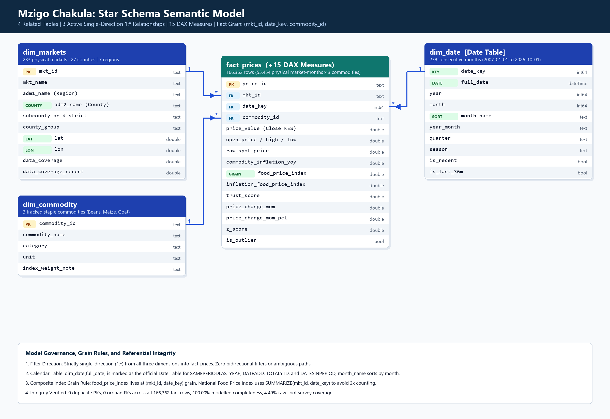

# Week 3 Data Model and DAX Measure Catalogue

**Course:** DSA 3050A | Business Intelligence and Data Visualization (Group Project B)
**Project:** Mzigo Chakula (Kenya Food Price Inflation and Household Affordability, 2007 to 2026)
**Authors:** Prince Nzamuwe, Yizere Denis Derick
**Semantic Model Project:** `pbip/mzigo-chakula.pbip` (TMDL under `pbip/mzigo-chakula.SemanticModel/definition/`)

---

## 1. Star Schema Architecture and Grain Integrity

The semantic model organizes 166,362 market-month-commodity observations into a four-table star schema with single-direction filtering from dimension tables into `fact_prices`:

- `dim_markets` (233 rows, PK `mkt_id`): Physical Kenyan markets mapped deterministically to 27 counties, 7 regions, and `Arid & Semi-Arid (ASAL)` (16 counties, 202 markets) versus `Agricultural & Urban` (11 counties, 31 markets). Geographic categories (`County`, `StateOrProvince`, `Latitude`, `Longitude`) are enabled for Power BI maps.
- `dim_date` (238 rows, PK `date_key`): Continuous monthly calendar from 2026 back to 2007 (`2007-01-01` to `2026-10-01`). `dim_date[full_date]` is marked as the official Date Table and `month_name` is sorted by `month` (`1` to `12`).
- `dim_commodity` (3 rows, PK `commodity_id`): Lookup dimension mapping `beans` (`Beans (1 kg)`), `maize_fao` (`Maize (1 kg)`), and `livestock_goat_s_fao` (`Goat (1 head)`) with explicit food categories and physical units (`KG`, `Head`).
- `fact_prices` (166,362 rows, PK `price_id`): One row per `(mkt_id, date_key, commodity_id)`. Foreign keys (`mkt_id`, `date_key`, `commodity_id`) are hidden from Report View so slicers always filter through dimension tables.

**Grain Protection Rule:** Each physical market-month carries one composite `food_price_index` value in the raw CSV, so unpivoting three commodities repeats that market-month index three times inside `fact_prices`. The `[National Food Price Index]` measure wraps `SUMMARIZE(fact_prices, fact_prices[mkt_id], fact_prices[date_key])` so every market-month enters the index mean once even when multiple commodities are selected.



---

## 2. Model Relationships and Integrity Verification

| Relationship | From Table (Many) | To Table (One) | Cardinality | Filter Direction | Status | Orphan Rows |
| --- | --- | --- | --- | --- | --- | ---: |
| `fact_prices_to_dim_markets` | `fact_prices[mkt_id]` | `dim_markets[mkt_id]` | `*:1` | Single (`dim_markets` filters `fact_prices`) | Active | 0 |
| `fact_prices_to_dim_date` | `fact_prices[date_key]` | `dim_date[date_key]` | `*:1` | Single (`dim_date` filters `fact_prices`) | Active | 0 |
| `fact_prices_to_dim_commodity` | `fact_prices[commodity_id]` | `dim_commodity[commodity_id]` | `*:1` | Single (`dim_commodity` filters `fact_prices`) | Active | 0 |

---

## 3. Complete DAX Measure Catalogue (15 Measures)

### 1. `Avg Price (KES)`

- **Table / Folder:** `fact_prices` / `01. Core Price & Index`
- **Format String:** `#,0.00`
- **Purpose:** Mean closing commodity price in KES within the active filter context.

```dax
AVERAGE(fact_prices[price_value])
```

### 2. `National Food Price Index`

- **Table / Folder:** `fact_prices` / `01. Core Price & Index`
- **Format String:** `0.00`
- **Purpose:** Grain-safe mean closing composite food price index averaged at the distinct (mkt_id, date_key) grain so unpivoting three commodities does not triple-count index weight.

```dax
AVERAGEX(
    SUMMARIZE(fact_prices, fact_prices[mkt_id], fact_prices[date_key]),
    CALCULATE(AVERAGE(fact_prices[food_price_index]))
)
```

### 3. `Prior Year Price (KES)`

- **Table / Folder:** `fact_prices` / `02. Time Intelligence & Growth`
- **Format String:** `#,0.00`
- **Purpose:** Mean closing commodity price shifted back 12 months via gap-safe EDATE and TREATAS.

```dax
VAR PriorDates =
    SELECTCOLUMNS(
        VALUES(dim_date[full_date]),
        "prior_date", EDATE(dim_date[full_date], -12)
    )
RETURN
    CALCULATE(
        [Avg Price (KES)],
        REMOVEFILTERS(dim_date),
        TREATAS(PriorDates, dim_date[full_date])
    )
```

### 4. `YoY Inflation %`

- **Table / Folder:** `fact_prices` / `02. Time Intelligence & Growth`
- **Format String:** `0.00%`
- **Purpose:** Year-over-year percentage change in the grain-safe composite food price index.

```dax
VAR CurrentIdx = [National Food Price Index]
VAR PriorDates =
    SELECTCOLUMNS(
        VALUES(dim_date[full_date]),
        "prior_date", EDATE(dim_date[full_date], -12)
    )
VAR PriorYearIdx =
    CALCULATE(
        [National Food Price Index],
        REMOVEFILTERS(dim_date),
        TREATAS(PriorDates, dim_date[full_date])
    )
RETURN
    DIVIDE(CurrentIdx - PriorYearIdx, PriorYearIdx)
```

### 5. `Commodity YoY Inflation %`

- **Table / Folder:** `fact_prices` / `02. Time Intelligence & Growth`
- **Format String:** `0.00%`
- **Purpose:** Year-over-year percentage change in average commodity price (KES).

```dax
VAR CurrentPrice = [Avg Price (KES)]
VAR PriorYearPrice = [Prior Year Price (KES)]
RETURN
    DIVIDE(CurrentPrice - PriorYearPrice, PriorYearPrice)
```

### 6. `MoM Change %`

- **Table / Folder:** `fact_prices` / `02. Time Intelligence & Growth`
- **Format String:** `0.00%`
- **Purpose:** Month-over-month percentage change in average commodity price via gap-safe EDATE.

```dax
VAR CurrentPrice = [Avg Price (KES)]
VAR PriorDates =
    SELECTCOLUMNS(
        VALUES(dim_date[full_date]),
        "prior_date", EDATE(dim_date[full_date], -1)
    )
VAR PriorMonthPrice =
    CALCULATE(
        [Avg Price (KES)],
        REMOVEFILTERS(dim_date),
        TREATAS(PriorDates, dim_date[full_date])
    )
RETURN
    DIVIDE(CurrentPrice - PriorMonthPrice, PriorMonthPrice)
```

### 7. `Price Volatility (KES)`

- **Table / Folder:** `fact_prices` / `03. Risk & Seasonality`
- **Format String:** `#,0.00`
- **Purpose:** Sample standard deviation of monthly closing prices in KES.

```dax
STDEV.S(fact_prices[price_value])
```

### 8. `Price Volatility CV %`

- **Table / Folder:** `fact_prices` / `03. Risk & Seasonality`
- **Format String:** `0.00%`
- **Purpose:** Unit-safe coefficient of variation computed per commodity for cross-commodity comparisons.

```dax
AVERAGEX(
    VALUES(fact_prices[commodity_id]),
    DIVIDE([Price Volatility (KES)], [Avg Price (KES)])
)
```

### 9. `Cumulative Index YTD`

- **Table / Folder:** `fact_prices` / `02. Time Intelligence & Growth`
- **Format String:** `0.00`
- **Purpose:** Year-to-date running mean composite food price index within the anchor year.

```dax
VAR AnchorDate = MAX(dim_date[full_date])
VAR AnchorYear = YEAR(AnchorDate)
RETURN
    CALCULATE(
        [National Food Price Index],
        REMOVEFILTERS(dim_date),
        dim_date[year] = AnchorYear,
        dim_date[full_date] <= AnchorDate
    )
```

### 10. `County Inflation Rank`

- **Table / Folder:** `fact_prices` / `04. Coverage & Disparities`
- **Format String:** `0`
- **Purpose:** Dense descending rank of Kenyan counties by YoY food index inflation (1 = highest inflation).

```dax
IF(
    ISINSCOPE(dim_markets[adm2_name]),
    RANKX(ALL(dim_markets[adm2_name]), [YoY Inflation %], , DESC, Dense)
)
```

### 11. `Data Completeness %`

- **Table / Folder:** `fact_prices` / `04. Coverage & Disparities`
- **Format String:** `0.00%`
- **Purpose:** Share of expected market-month-commodity cells populated with non-null modelled closing prices.

```dax
VAR ObservedRows = COUNTROWS(fact_prices)
VAR ExpectedRows = COUNTROWS(dim_markets) * COUNTROWS(dim_date) * COUNTROWS(dim_commodity)
RETURN
    DIVIDE(ObservedRows, ExpectedRows)
```

### 12. `Survey Coverage Rate %`

- **Table / Folder:** `fact_prices` / `04. Coverage & Disparities`
- **Format String:** `0.00%`
- **Purpose:** Share of market-month-commodity records backed by a direct raw field survey observation.

```dax
DIVIDE(COUNT(fact_prices[raw_spot_price]) + 0, COUNTROWS(fact_prices))
```

### 13. `Affordability Gap (KES)`

- **Table / Folder:** `fact_prices` / `04. Coverage & Disparities`
- **Format String:** `#,0.00`
- **Purpose:** Unit-safe local price premium or discount in KES compared to the national mean.

```dax
AVERAGEX(
    VALUES(fact_prices[commodity_id]),
    VAR LocalAvg = [Avg Price (KES)]
    VAR NationalAvg = CALCULATE([Avg Price (KES)], ALL(dim_markets))
    RETURN
        LocalAvg - NationalAvg
)
```

### 14. `Seasonal Index`

- **Table / Folder:** `fact_prices` / `03. Risk & Seasonality`
- **Format String:** `0.000`
- **Purpose:** Ratio of a calendar month or season average price to the all-month average (>1.000 = seasonal peak).

```dax
VAR CurrentMonthAvg = [Avg Price (KES)]
VAR AllMonthsAvg = CALCULATE([Avg Price (KES)], ALL(dim_date[month], dim_date[month_name], dim_date[season], dim_date[quarter]))
RETURN
    DIVIDE(CurrentMonthAvg, AllMonthsAvg)
```

### 15. `12-Month Rolling Avg (KES)`

- **Table / Folder:** `fact_prices` / `02. Time Intelligence & Growth`
- **Format String:** `#,0.00`
- **Purpose:** Trailing 12-month smoothed commodity price average via gap-safe EDATE.

```dax
VAR AnchorDate = MAX(dim_date[full_date])
VAR StartDate = EDATE(AnchorDate, -11)
RETURN
    CALCULATE(
        AVERAGEX(
            VALUES(dim_date[full_date]),
            [Avg Price (KES)]
        ),
        REMOVEFILTERS(dim_date),
        dim_date[full_date] >= StartDate,
        dim_date[full_date] <= AnchorDate
    )
```

---

## 4. DAX Validation Results Against Python Reference Engine

### Overall Model KPI Benchmarks

| Measure | Evaluation Slice | Computed Value |
| --- | --- | ---: |
| `National Food Price Index` | Full Span (`2007-01-01` to `2026-10-01`) | 1.2005 |
| `National Food Price Index` | Recent 12 Months (`2025-11-01` to `2026-10-01`) | 1.8837 |
| `National Food Price Index` | Prior 12 Months (`2024-11-01` to `2025-10-01`) | 1.7513 |
| `YoY Inflation %` | Recent 12 Months vs. Prior 12 Months | 7.56% |
| `Cumulative Index YTD` | Calendar Year 2026 (`2026-01-01` to `2026-10-01`) | 1.9189 |
| `Data Completeness %` | Full Model (`166,362 / (233 x 238 x 3)`) | 100.00% |
| `Survey Coverage Rate %` | Raw Non-Null Spot Observations (`7,470 / 166,362`) | 4.49% |

### Per-Commodity Measures and Food Index Co-Movement

| Commodity | `Avg Price (KES)` Full | `Avg Price (KES)` 12m | `Commodity YoY Inflation %` 12m | Latest `MoM Change %` (Oct 2026) | `Price Volatility (KES)` | `Price Volatility CV %` | `12-Month Rolling Avg (KES)` | Corr `r` vs. Index | R-Squared vs. Index |
| --- | ---: | ---: | ---: | ---: | ---: | ---: | ---: | ---: | ---: |
| Beans (1 kg) | 105.69 | 150.42 | +0.55% | +0.56% | 32.79 | 31.02% | 150.42 | 0.6916 | 47.83% |
| Maize (1 kg) | 56.02 | 80.13 | -10.51% | +0.21% | 22.72 | 40.56% | 80.13 | 0.4398 | 19.34% |
| Goat (1 head) | 3,456.14 | 5,438.29 | +7.77% | +2.84% | 2,928.08 | 84.72% | 5,438.29 | 1.0000 | 99.99% |

### ASAL vs. Agricultural & Urban Comparison (`group_comparison`)

| County Group | Fact Rows | Food Index Mean | Food Index CV % | Maize CV % | Beans CV % | Goat CV % | Mean Abs MoM % | Outlier Rate |
| --- | ---: | ---: | ---: | ---: | ---: | ---: | ---: | ---: |
| Arid & Semi-Arid (ASAL) | 144,228 | 1.195 | 83.70% | 40.21% | 30.82% | 85.64% | 4.56% | 1.14% |
| Agricultural & Urban | 22,134 | 1.233 | 77.28% | 38.52% | 31.89% | 78.82% | 5.08% | 1.03% |

---

## 5. Quantitative Answers to the 5 Project Analytical Questions

### Q1. Which counties experienced the highest 12-month food price inflation over the last three years (2024 to 2026)?

In this World Bank Kenya release, livestock goat prices and the composite `c_food_price_index` hit an extraordinary peak in 2023 (annual mean `3.465`, goat `10,106 KES`), declined through 2024 (`3.031`) and 2025 (`1.744`), and rose again in 2026 (`1.919`). Because the 36-month window (`2023-11` to `2026-10` vs. `2022-11` to `2025-10`) spans the descent from that 2023 peak, every county shows a negative 3-year index average, with coastal and eastern counties holding the highest relative rank (smallest drop from 2023). Over the most recent 12 months (`2025-11` to `2026-10` vs. prior 12 months), overall national index inflation returned to **+7.56%**, led by the counties below:

| Rank (Recent 12m) | County | Group | Markets | Recent 12m `YoY Inflation %` | Last 36m Mean `YoY Inflation %` | Rank (Last 36m) |
| ---: | --- | --- | ---: | ---: | ---: | ---: |
| 1 | Tharaka Nithi | Agricultural & Urban | 2 | +25.13% | -7.11% | 7 |
| 2 | Marsabit | Arid & Semi-Arid (ASAL) | 19 | +19.85% | -8.13% | 11 |
| 3 | Kisumu | Agricultural & Urban | 2 | +18.43% | -13.31% | 26 |
| 4 | Nakuru | Agricultural & Urban | 2 | +17.52% | -10.98% | 24 |
| 5 | Samburu | Arid & Semi-Arid (ASAL) | 20 | +16.35% | -9.62% | 17 |

Highest-ranking counties across the full 36-month window (`2023-11` to `2026-10` relative to `2022-11` to `2025-10`): Kwale (-3.61%), Mombasa (-5.56%), Embu (-6.05%), Garissa (-6.62%), Kilifi (-6.77%).

### Q2. Which tracked commodity drives the largest share of movements in the composite food price index?

Although the CSV `components` text column lists `livestock_goat_s_fao (1 unit, Index Weight = 0)`, empirical correlation across all 55,454 physical market-months shows that `Goat (1 head)` tracks `c_food_price_index` with `r = 0.99996` (`R^2 = 99.99%` for price levels and `r = 0.99979` for YoY index rates). `Beans (1 kg)` shows `r = 0.6916` (`R^2 = 47.83%`), and `Maize (1 kg)` shows `r = 0.4398` (`R^2 = 19.34%`). Because one live goat trades around 3,456 KES per head compared to 56 KES/kg for maize and 106 KES/kg for beans, goat price levels account for virtually all movement in the unscaled index series. Dashboard visuals therefore evaluate individual staple commodities via `[Avg Price (KES)]` and `[Commodity YoY Inflation %]` alongside the composite index.

### Q3. Is price volatility higher in ASAL counties than in agricultural and urban counties?

Across the composite Food Price Index (CV `83.70%` vs. `77.28%`), Maize (`40.21%` vs. `38.52%`), and Goats (`85.64%` vs. `78.82%`), ASAL counties (`16` counties, `202` markets) exhibit higher price dispersion and outlier rates (`1.14%` vs. `1.03%`) than Agricultural & Urban counties (`11` counties, `31` markets), whereas dry Beans CV is slightly higher in Agricultural & Urban markets (`31.89%` vs. `30.82%`). Mean maize prices are `+9.75 KES/kg` higher in ASAL markets.

Maize `Affordability Gap (KES)` extremes (County average vs. `56.02 KES/kg` national physical-market mean):
- Highest cost burden: Turkana (+15.26 KES/kg), Mandera (+10.65 KES/kg), Kisumu (+9.89 KES/kg), Wajir (+3.94 KES/kg), West Pokot (+2.44 KES/kg).
- Lowest cost burden: Lamu (-17.51 KES/kg), Kitui (-15.59 KES/kg), Embu (-13.88 KES/kg), Tharaka Nithi (-13.73 KES/kg), Meru (-12.99 KES/kg).

### Q4. What seasonal price cycles repeat across the year?

| Season Window | Beans `Seasonal Index` | Maize `Seasonal Index` | Goat `Seasonal Index` |
| --- | ---: | ---: | ---: |
| Hot Dry / Lean (Jan-Feb) | 0.970 | 0.972 | 1.060 |
| Long Rains (Mar-May) | 0.994 | 0.981 | 0.974 |
| Cool Dry / Harvest (Jun-Sep) | 1.013 | 1.023 | 0.968 |
| Short Rains (Oct-Dec) | 1.009 | 1.007 | 1.030 |

Staple maize peaks during `Cool Dry / Harvest (Jun-Sep)` (`1.023`) and dips during `Hot Dry / Lean (Jan-Feb)` (`0.972`), while dry beans peak in `Cool Dry / Harvest (Jun-Sep)` (`1.013`) and reach their low in `Hot Dry / Lean (Jan-Feb)` (`0.970`). Live goats stay firmest during `Hot Dry / Lean (Jan-Feb)` (`1.060`) and lowest in `Cool Dry / Harvest (Jun-Sep)` (`0.968`).

### Q5. How uneven is market coverage across counties and where are survey gaps largest?

While modelled closing prices fill 100.00% of the `233 x 238 x 3` grid, raw field observations cover only `4.49%` of cells overall and differ dramatically by county and market count. Five counties (`Embu`, `Lamu`, `Machakos`, `Nyeri`, `Uasin Gishu`) rely on just one monitored market, whereas `Turkana` alone accounts for `57` markets (`24.5%` of all markets).

| Group | Counties | Lowest vs. Highest `Survey Coverage Rate %` |
| --- | --- | --- |
| Lowest Survey Coverage | Kisumu (0.00%), Machakos (0.00%), Nakuru (0.00%), Nyeri (0.00%), Samburu (0.00%) | Remote / high-market-count northern counties and large urban wholesale hubs |
| Highest Survey Coverage | Embu (58.40%), Lamu (58.40%), Kitui (39.50%), Taita Taveta (31.72%), Kwale (26.82%) | Single- or few-market benchmark stations with regular survey logs |
