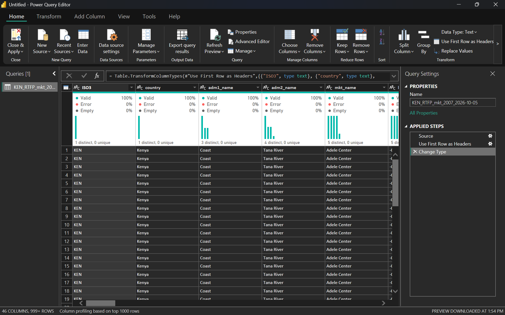

# Mzigo Chakula: Food Price Inflation and Household Affordability Intelligence for Kenya

**Course:** DSA 3050A | Business Intelligence and Data Visualization (Group Project B)
**Project Area:** 10. Food-price inflation and household affordability
**Group Members:** Prince Nzamuwe, Yizere Denis Derick
**Date:** 14 November 2026

## 1. Problem Statement

Public inflation reports in Kenya summarize food costs as one national percentage, which hides sharp regional differences across counties. A household in Turkana or Mandera buys staple maize, beans, and livestock under very different supply conditions and seasonal shocks than a household in Nairobi or Mombasa. Over the past two decades, drought cycles, fuel costs, and exchange-rate movements have pushed staple prices up unevenly across urban centres and arid regions.

This project builds a Power BI decision tool to measure how retail food prices and price volatility shifted across Kenyan markets between January 2007 and October 2026. The goal is to show which counties, commodities, and calendar months carry the heaviest cost burden so planners can direct subsidies and monitoring where pressure is highest.

## 2. Stakeholders and Supported Decisions

The primary users are county agricultural and planning officers, NGO food-security teams, and household policy analysts. The report supports three operational decisions:

1. **Where to allocate field price-monitoring effort:** Pair high-volatility counties with survey coverage records to locate markets that face large price swings with thin recent field checks.
2. **When to open seasonal food subsidies or relief distributions:** Identify recurring harvest-gap peak months per county so interventions arrive before prices peak.
3. **Which commodity to prioritize:** Measure whether maize, beans, or livestock contributes most to local index inflation so response budgets target the strongest price driver.

## 3. Analytical Questions

1. Which Kenyan counties experienced the highest 12-month food price inflation over the last three years (2024 to 2026)?
2. Which tracked commodity (maize, beans, or goats) drives the largest share of changes in the composite food price index?
3. Is monthly price volatility higher in arid and semi-arid counties (such as Turkana, Marsabit, Mandera, Wajir, and Garissa) than in higher-potential agricultural or urban counties?
4. What seasonal price cycles repeat across the year, and how do peak months differ between regions?
5. How uneven is market density across counties, and which counties rely on a single monitored market?

## 4. Key Performance Indicators

| KPI | Definition | Why It Matters |
| --- | --- | --- |
| National Food Price Index | Average closing composite food price index (`c_food_price_index`) across physical markets | Tracks overall basket cost trend across periods |
| YoY Inflation Rate (%) | Percentage change in price or index against the same month one year earlier | Separates sustained inflation from normal seasonal swings |
| Price Volatility (KES / Std Dev) | Standard deviation of monthly closing prices per commodity and county | Measures price instability and household budget risk |
| Market Coverage Rate (%) | Share of expected market-month observations with valid modelled prices and raw surveys | Flags data reliability differences before drawing conclusions |
| Affordability Gap (KES) | County average commodity price minus the national market average for the same period | Quantifies local price premiums paid by households |

## 5. Dataset Summary and Main Fields

| Attribute | Detail |
| --- | --- |
| Source | World Bank Real Time Food Prices (RTFP), Kenya |
| Source URL | https://microdata.worldbank.org/index.php/catalog/6167 |
| Date Accessed | 29 October 2026 |
| License | CC BY 4.0 (open redistribution permitted with attribution) |
| File Path | `data/raw/KEN_RTFP_mkt_2007_2026-10-05.csv` |
| Dimensions | 55,692 rows and 46 columns |
| Geographic Scope | 233 physical markets (plus 1 `Market Average` national series) across 27 counties |
| Time Span | January 2007 to October 2026 (238 consecutive months) |

Main fields include `adm1_name`, `adm2_name`, `mkt_name`, `lat`, `lon`, `geo_id`, `price_date`, `year`, `month`, modelled close prices (`c_beans`, `c_maize_fao`, `c_livestock_goat_s_fao`), `c_food_price_index`, YoY inflation columns (`inflation_*`), and model trust scores (`trust_*`). All 46 fields with types, units, null rates, ranges, and descriptions are listed in `docs/dataset-dictionary.csv`.

## 6. Initial Data Quality Assessment

Profiling all 55,692 rows surfaced four cleaning rules for Week 2 Power Query work. First, 238 rows belong to a synthetic `Market Average` series with blank coordinates (`lat` and `lon` missing on 0.43% of rows) that must be excluded from market-level sums and averages. Second, the raw survey price columns (`beans`, `maize_fao`, `livestock_goat_s_fao`) are missing on 94.53% to 96.72% of rows, whereas the 16 modelled OHLC columns (`o_`, `h_`, `l_`, `c_`) have 0.00% missingness and supply a continuous 238-month series. Third, the four `inflation_*` columns are blank for all 12 months of 2007 (2,808 rows, 5.04%) because 2006 prices are absent. Fourth, `adm1_name` and `adm2_name` mix former provinces with modern counties across 35 pairs (for example, splitting Kwale, Kajiado, Tana River, Taita Taveta, and Meru), requiring a deterministic lookup table to normalize all 233 markets into 27 counties and 7 regions.

## 7. Limitations and Ethics

The dataset reports market-level aggregate retail prices without household income or expenditure figures, so affordability is inferred from price levels and cross-county gaps. Market density is uneven: 27 of Kenya's 47 counties are represented, Turkana has 57 markets while five counties have only 1 market, and Western Province has zero markets in this release. All prices are public aggregate market series under CC BY 4.0 with no personal or sensitive data.

## 8. Initial Power BI Import Evidence

Power Query Editor screenshot captured immediately upon importing `data/raw/KEN_RTFP_mkt_2007_2026-10-05.csv` (showing 46 columns, 999+ rows in the 1,000-row profiling preview, column quality and distribution bars, and Power BI's default CSV import steps `Source`, `Use First Row as Headers`, and `Change Type` under Applied Steps):

